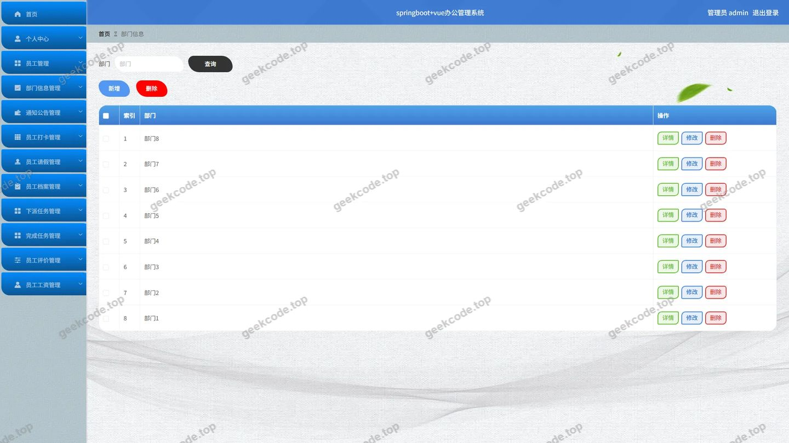
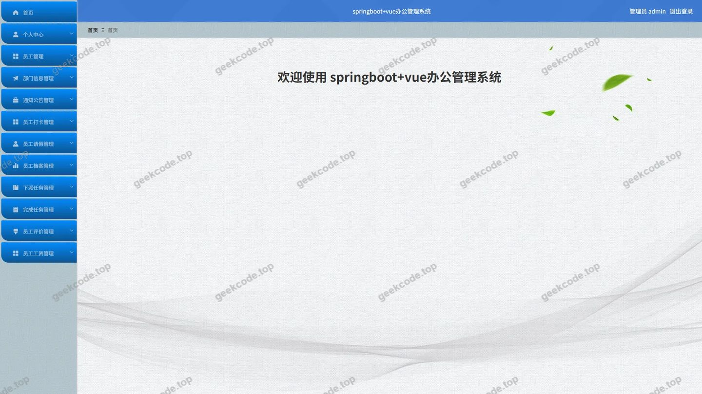
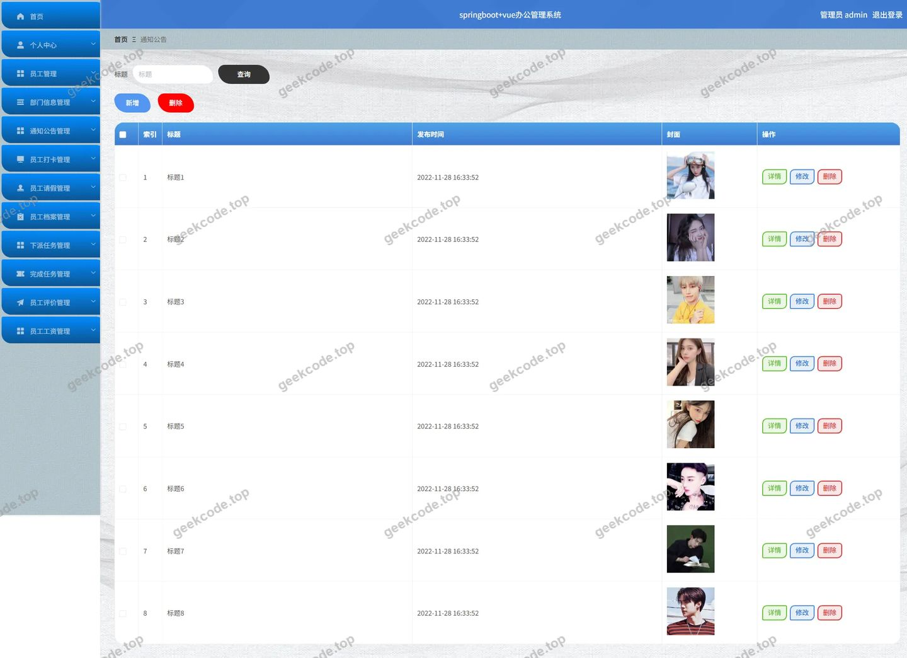
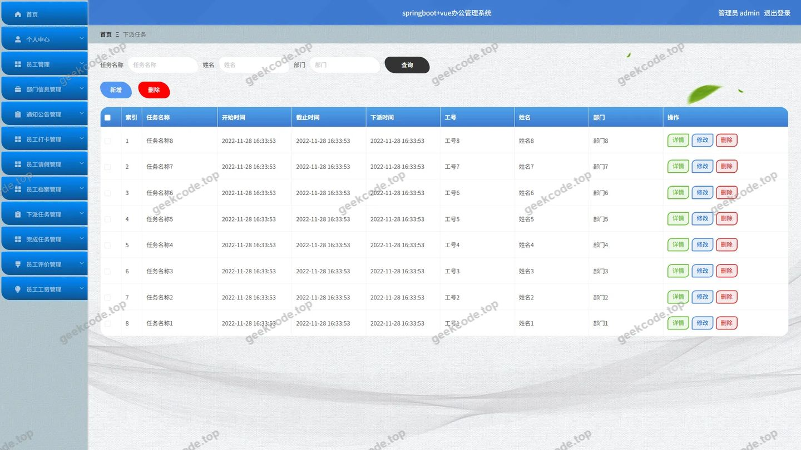
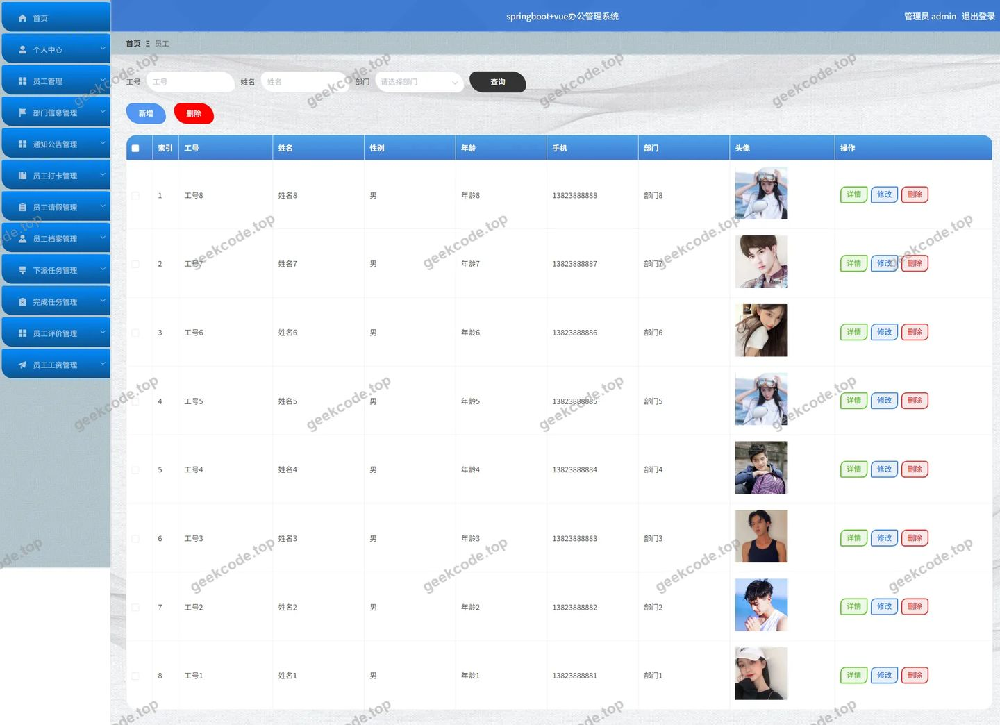
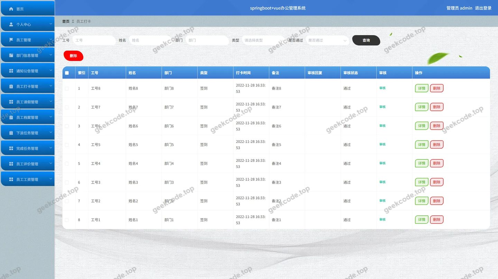
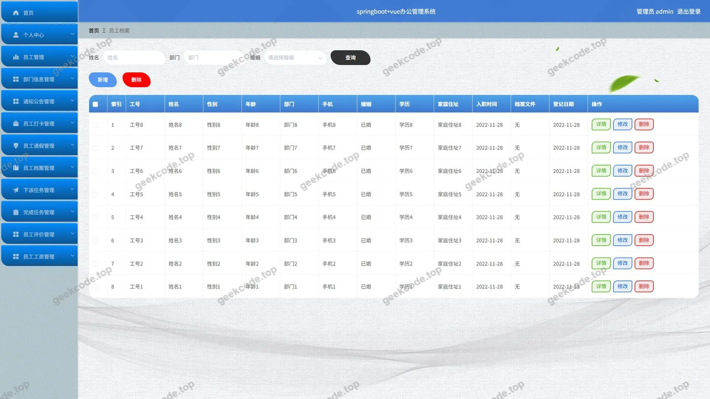
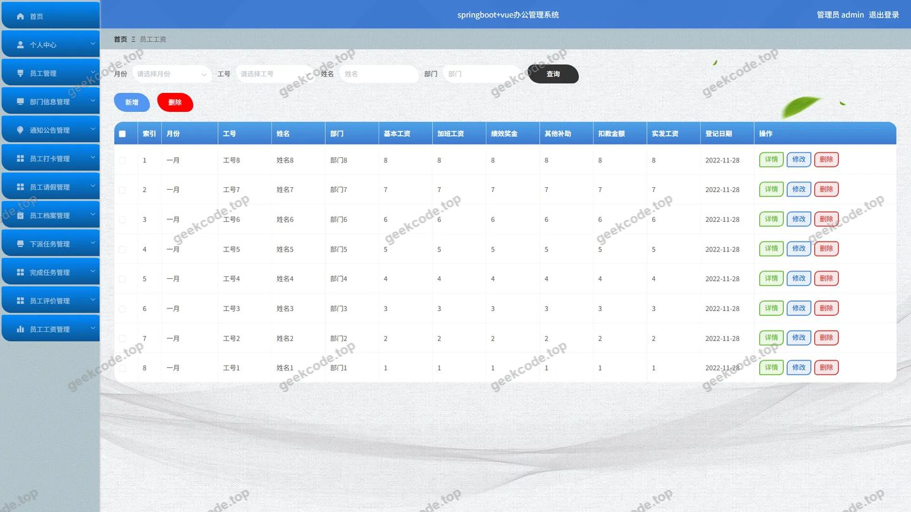
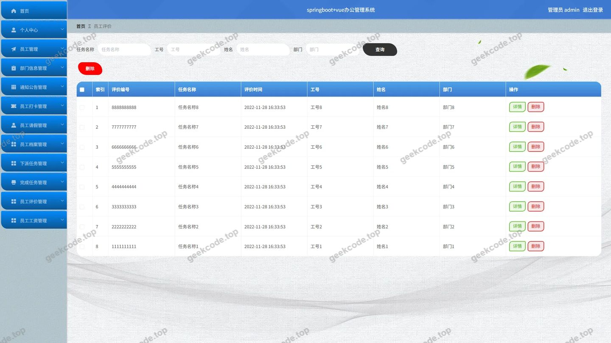

# springboot+vue办公管理系统

> 🎓 **计算机毕业设计 · springboot+vue办公管理系统**
>
> 本仓库只放**项目介绍 + 运行截图**（截图是站点带水印的原图，存在仓库 `images/` 里）。
>
> 👉 **完整可运行源码 / 数据库脚本 / 部署文档：[点我获取](https://geekcode.top/archives/springboot-vue%E5%8A%9E%E5%85%AC%E7%AE%A1%E7%90%86%E7%B3%BB%E7%BB%9F?utm_source=github)**
>
> 💬 咨询微信：**ir9372**　|　🌐 更多项目：[极客代码 geekcode.top](https://geekcode.top/?utm_source=github)
>
> 📌 项目详情页：<https://geekcode.top/archives/springboot-vue%E5%8A%9E%E5%85%AC%E7%AE%A1%E7%90%86%E7%B3%BB%E7%BB%9F?utm_source=github>

<table><td width="230" align="center"> <b>扫码加微信 ir9372</b></td><td valign="middle">📦 源码 = 项目介绍 + 全部运行截图 + 数据库 + 部署文档 👉 点上方任意截图，直接跳到 <b>极客代码 geekcode.top</b> 详情页</td></table>

---

<h1>springboot+vue办公管理系统</h1>
<h2>项目概述</h2>

本项目是一款基于前后端分离架构的办公管理系统，旨在通过数字化手段提升企业内部行政与人力资源管理的效率。系统核心功能涵盖部门信息管理、员工全生命周期管理（档案、评价、工资）、日常事务处理（请假、打卡）以及任务协同（下派任务、完成任务）和信息发布（通知公告）。适用人群主要为企事业单位的行政管理人员及HR专员。技术架构采用 Spring Boot 作为后端服务框架，结合 MyBatis-Plus 进行数据持久化操作，使用 Shiro 实现安全权限控制；前端采用 Vue.js 构建单页应用，实现了后台管理界面的高效交互与数据展示。

<h2>技术架构</h2>
<h3>后端架构</h3>

后端基于 Java 语言开发，主要依赖以下核心技术栈：

<ul>
<li><strong>Spring Boot</strong>: 提供快速开发的微服务基础框架，简化配置并集成 Web 容器。</li>
<li><strong>MyBatis-Plus</strong>: 在 MyBatis 基础上增强 CRUD 操作，支持 Lambda 表达式查询，提升数据库访问层的开发效率。</li>
<li><strong>Apache Shiro</strong>: 负责身份认证与授权管理，确保系统访问的安全性，防止未授权用户访问敏感数据。</li>
<li><strong>MySQL</strong>: 作为关系型数据库存储业务数据，包括用户信息、部门结构、考勤记录等。</li>
</ul>
<h3>前端架构</h3>

前端采用 Vue.js 框架构建后台管理系统。通过路由映射实现不同功能模块页面的切换，利用 Axios 或 Fetch API 与后端 RESTful 接口进行异步数据交互，实现数据的动态渲染与表单提交。

<h3>数据库设计要点</h3>

数据库设计遵循第三范式，主要实体表包括：

<ul>
<li><strong>用户表 (Users)</strong>: 存储管理员登录信息及权限标识。</li>
<li><strong>部门信息表 (Bumenxinxi)</strong>: 维护组织架构层级。</li>
<li><strong>员工主表 (Yuangong)</strong>: 关联部门ID，存储员工基本信息。</li>
<li><strong>业务扩展表</strong>: 分别对应请假 (<code>yuangongqingjia</code>)、工资 (<code>yuangonggongzi</code>)、打卡 (<code>yuangongdaka</code>)、档案 (<code>yuangongdangan</code>)、评价 (<code>yuangongpingjia</code>)、任务 (<code>xiapairenwu</code>, <code>wanchengrenwu</code>) 及公告 (<code>tongzhigonggao</code>)，通过外键与员工或部门关联，确保数据一致性。</li>
</ul>
<h2>功能模块</h2>

根据源码中的 Controller 列表及后台路由配置，系统仅包含后台管理端功能，无前台用户端界面。具体模块如下：

<h3>1. 系统基础管理</h3>
<ul>
<li><strong>用户管理 (<code>/users</code>)</strong>: 管理员账号的增删改查及登录状态维护。</li>
<li><strong>配置管理 (<code>/config</code>)</strong>: 系统全局参数配置。</li>
<li><strong>文件管理 (<code>/file</code>)</strong>: 上传文件的存储与管理。</li>
<li><strong>收藏管理 (<code>/storeup</code>)</strong>: 用户收藏内容的记录（虽Controller存在，但截图未显示独立菜单，推测为内部辅助功能）。</li>
</ul>
<h3>2. 组织与人员管理</h3>
<ul>
<li><strong>部门信息管理 (<code>/bumenxinxi</code>)</strong>: 添加、修改、删除及查询部门详情。</li>
<li><strong>员工信息管理 (<code>/yuangong</code>)</strong>: 员工入职、离职、信息变更等核心档案管理。</li>
<li><strong>员工档案管理 (<code>/yuangongdangan</code>)</strong>: 存储员工的详细背景资料、合同信息等。</li>
<li><strong>员工评价管理 (<code>/yuangongpingjia</code>)</strong>: 记录对员工的工作绩效评估数据。</li>
</ul>
<h3>3. 日常事务管理</h3>
<ul>
<li><strong>员工请假管理 (<code>/yuangongqingjia</code>)</strong>: 处理员工的请假申请审批流程。</li>
<li><strong>员工打卡管理 (<code>/yuangongdaka</code>)</strong>: 记录员工的每日出勤情况。</li>
<li><strong>员工工资管理 (<code>/yuangonggongzi</code>)</strong>: 薪资数据的录入、计算与发放记录。</li>
</ul>
<h3>4. 任务与协作管理</h3>
<ul>
<li><strong>下派任务管理 (<code>/xiapairenwu</code>)</strong>: 管理员创建并分配工作任务给指定员工。</li>
<li><strong>完成任务管理 (<code>/wanchengrenwu</code>)</strong>: 追踪任务的执行进度与完成状态反馈。</li>
</ul>
<h3>5. 信息发布</h3>
<ul>
<li><strong>通知公告管理 (<code>/tongzhigonggao</code>)</strong>: 发布公司内部通知、新闻或制度公告。</li>
</ul>
<h2>用户角色与权限</h2>

根据项目类型（vue-integrated）及截图显示，系统主要面向单一的管理员角色进行后台操作。

<table>
<thead>
<tr>
<th align="left">角色名称</th>
<th align="left">权限描述</th>
<th align="left">可访问的功能模块</th>
</tr>
</thead>
<tbody><tr>
<td align="left"><strong>管理员 (Admin)</strong></td>
<td align="left">拥有系统的最高权限，可进行所有业务数据的增删改查及系统配置。</td>
<td align="left">1. <strong>登录页</strong>: 系统入口2. <strong>首页</strong>: 数据概览3. <strong>部门信息</strong>: 查看与维护4. <strong>员工</strong>: 查看与维护5. <strong>员工请假</strong>: 审批与管理6. <strong>员工工资</strong>: 录入与查询7. <strong>下派任务</strong>: 创建与分配8. <strong>通知公告</strong>: 发布与管理9. <strong>员工档案</strong>: 详细资料管理10. <strong>员工评价</strong>: 绩效数据管理11. <strong>员工打卡</strong>: 考勤数据管理12. <strong>完成任务</strong>: 任务状态监控</td>
</tr>
</tbody></table>

<em>注：由于项目无前台路由且截图仅展示 Admin 视角，普通员工或其他角色的具体权限边界未在现有代码上下文中明确体现，通常此类系统中员工可能通过独立的移动端或受限账号登录查看个人数据，但本毕设文档严格基于提供的后台源码，故仅列出管理员权限。</em>

<h2>项目特色与创新点</h2>
<ol>
<li><strong>一体化办公闭环</strong>：系统将人事管理（档案、评价）、财务管理（工资）、行政管理（请假、打卡）与项目管理（任务下派与完成）整合在同一平台，打破了传统办公软件中的数据孤岛，实现了办公流程的全链路数字化。</li>
<li><strong>安全性保障</strong>：引入 Apache Shiro 框架进行细粒度的权限控制和会话管理，有效防止越权访问，保障了企业敏感数据（如工资、档案）的安全性。</li>
<li><strong>高效的数据交互</strong>：采用 Vue + Spring Boot 的前后端分离架构，使得界面响应速度快，用户体验流畅。MyBatis-Plus 的使用大幅减少了样板代码，提升了后端逻辑的开发与维护效率。</li>
<li><strong>模块化设计</strong>：各个业务模块（如请假、工资、任务）通过独立的 Controller 和 Service 层解耦，便于后续功能的扩展与维护，符合高内聚低耦合的软件工程原则。</li>
</ol>
<h2>部署环境</h2>

为确保项目正常运行，需准备以下软件环境：

<ul>
<li><strong>操作系统</strong>: Windows 10/11, macOS 或 Linux (CentOS/Ubuntu)。</li>
<li><strong>Java 运行环境</strong>: JDK 1.8 或更高版本（推荐 JDK 8 LTS）。</li>
<li><strong>数据库</strong>: MySQL 5.7 或 MySQL 8.0+，需初始化相关表结构。</li>
<li><strong>Web 服务器</strong>: 内置 Tomcat (由 Spring Boot 自动嵌入) 或外部 Nginx/Apache (用于生产环境反向代理)。</li>
<li><strong>前端构建工具</strong>: Node.js (建议 v12+), npm/yarn (用于编译 Vue 项目)。</li>
<li><strong>开发工具</strong>: IntelliJ IDEA 或 Eclipse (后端), VS Code (前端), Navicat (数据库管理)。</li>
</ul>
<h2>五、技术特性</h2>
<ul>
<li>前后端集成部署，前端资源打包至后端 static 目录</li>
<li>使用 MyBatis-Plus 简化数据访问层开发</li>
<li>集成 Shiro 权限框架实现角色权限控制</li>
</ul>
<h2>六、功能模块截图</h2>
<h3>后台管理端</h3>
<h4>后台-部门信息</h4>

<h4>后台首页</h4>

<h4>后台-登录</h4>

<h4>后台-通知公告</h4>

<h4>后台-完成任务</h4>

<h4>后台-下派任务</h4>

<h4>后台-员工</h4>

<h4>后台-员工打卡</h4>

<h4>后台-员工档案</h4>

<h4>后台-员工工资</h4>

<h4>后台-员工评价</h4>

<h4>后台-员工请假</h4>

---

## 获取完整源码

| 项目 | 说明 |
| --- | --- |
| 项目名 | springboot+vue办公管理系统 |
| 运行截图 | 本文 12 张（站点带水印原图，仓库 `images/` 目录） |
| 完整源码 | [https://geekcode.top/archives/springboot-vue%E5%8A%9E%E5%85%AC%E7%AE%A1%E7%90%86%E7%B3%BB%E7%BB%9F?utm_source=github](https://geekcode.top/archives/springboot-vue%E5%8A%9E%E5%85%AC%E7%AE%A1%E7%90%86%E7%B3%BB%E7%BB%9F?utm_source=github) |
| 咨询微信 | **ir9372**（备注：jingpin-yuanma） |
| 更多项目 | [极客代码 geekcode.top](https://geekcode.top/?utm_source=github) |

> 需要源码、部署、改配置、跑不起来等问题，加微信 ir9372 沟通，说明项目名即可。
